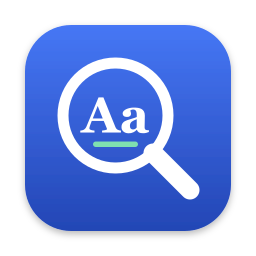
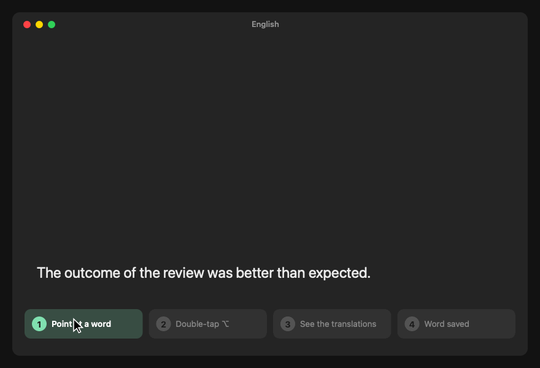
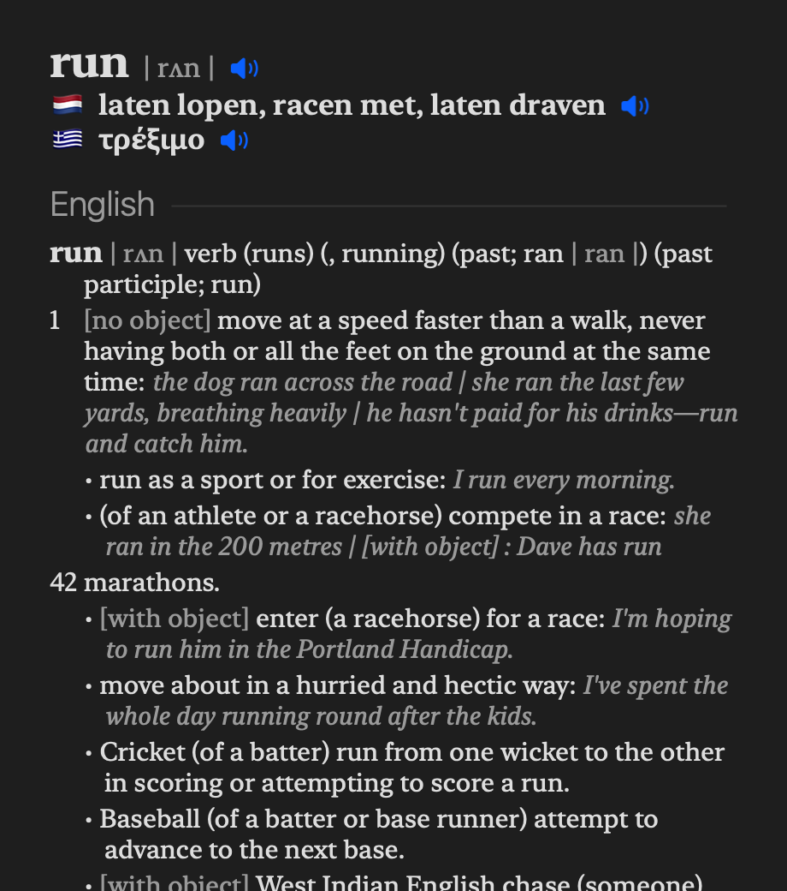
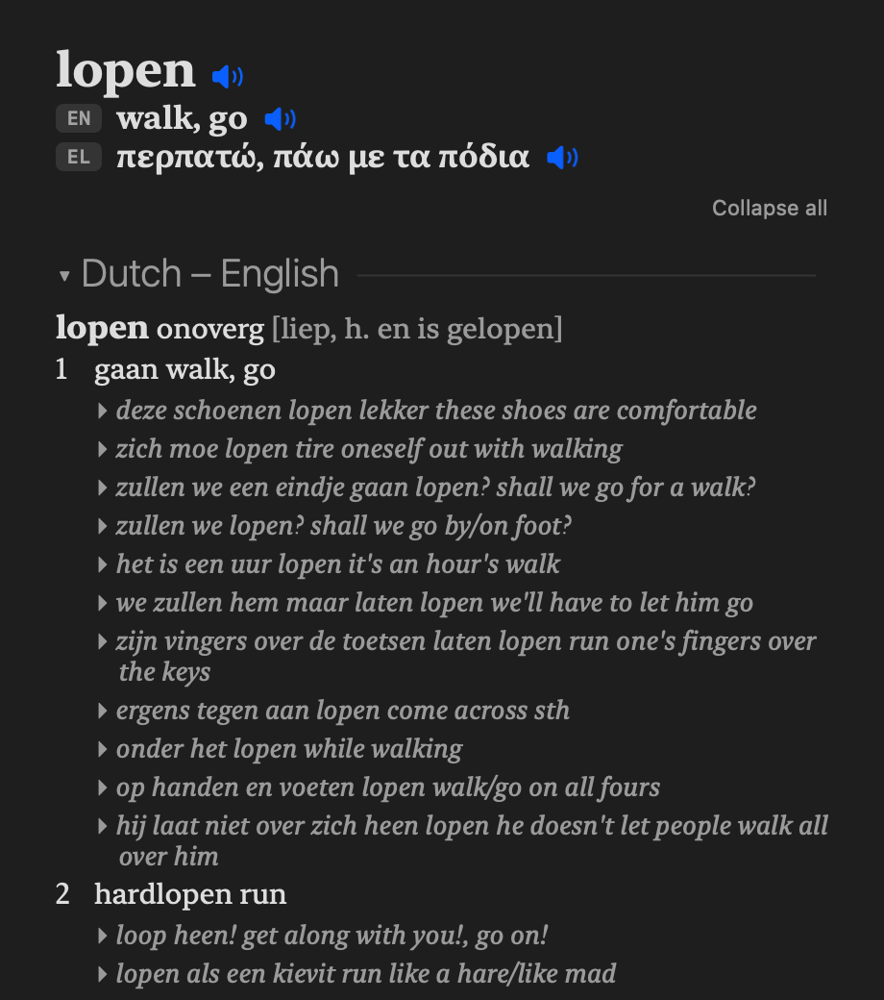
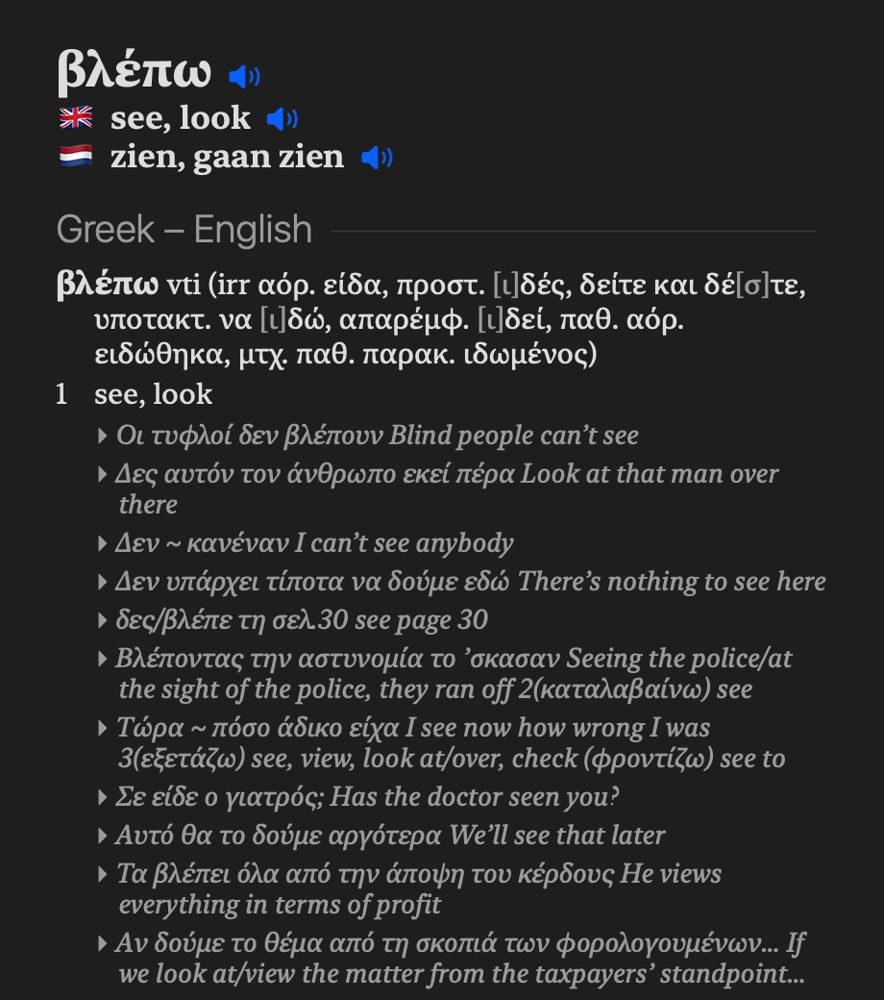
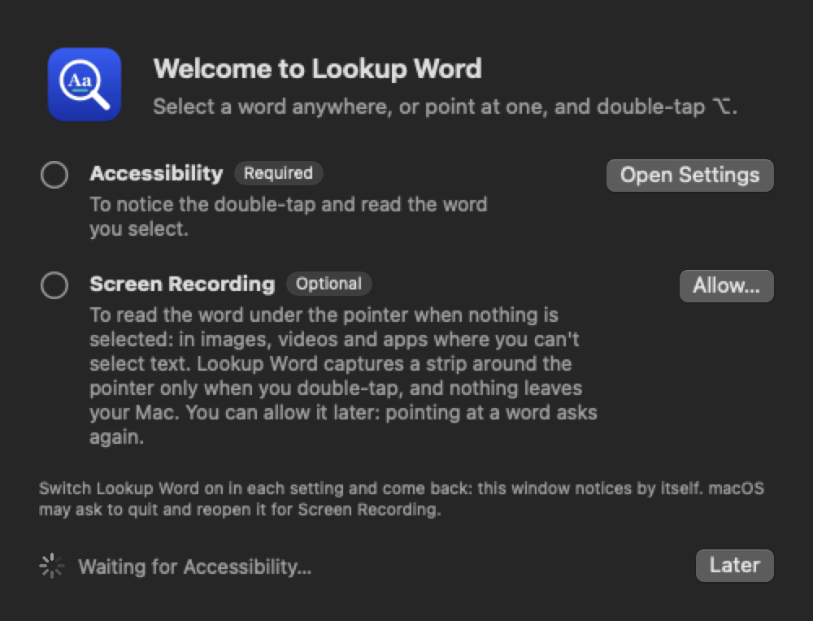
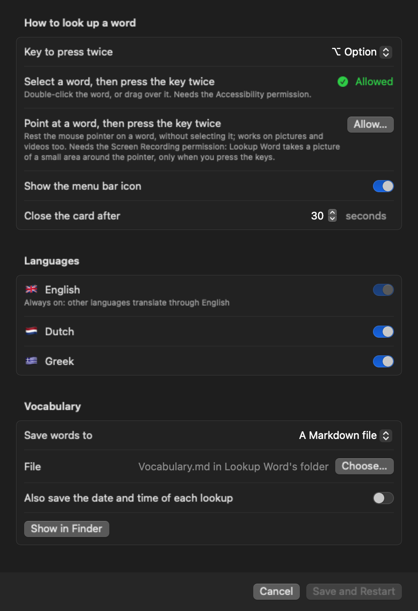
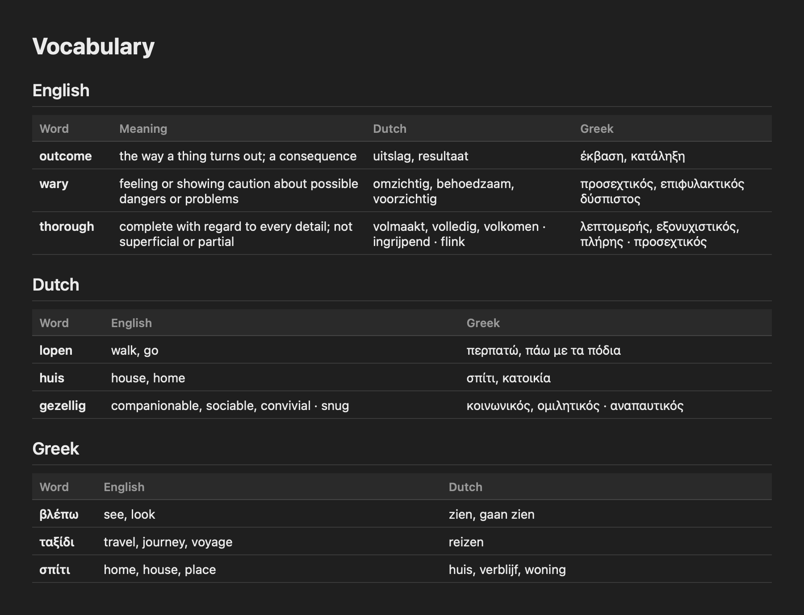

#  Lookup Word

Look Up for people who live in more than one language. Select a word anywhere on your Mac, or just point at it, and press the ⌥ Option key twice: a card
shows the word, its pronunciation, its translation into each of your other languages with a 🔈 to hear it, and the
full dictionary entries. Every word you look up is saved to a vocabulary file, so your word list builds itself from
what you actually read.

Everything runs on your Mac. It uses only the dictionaries in Apple's Dictionary.app: nothing you read is sent anywhere.



*The demo points at words; you can also select them. See [Use](#use).*

| English | Dutch | Greek |
|---|---|---|
|  |  |  |

## Why I built it

Greek is my mother tongue. I work in English, and I live in the Netherlands, where everything around me is in Dutch.
Every day I try to improve both of those languages while I work, so I keep meeting words I only half know.

1. I used the Mac's Look Up. It shows every dictionary's entry, but I had to read through them for what I wanted at a
   glance, the word in my other languages (an English word in Greek, a Dutch word in English and Greek), and I
   couldn't hear the translations.
2. For that I opened online dictionaries such as WordReference: switch to the browser, type the word, pick the language
   pair, wait, and read through the page. Each lookup took long enough to break the flow of the work I was reading for.
3. And the word was gone afterwards. Neither Look Up nor the browser kept a list, so the words I looked up were tracked
   nowhere.
4. Yet that list is what I learn from: I turn my words into flashcards and practise them on my phone with spaced
   repetition, but a word I looked up only reached that list when I copied it there by hand.

So Lookup Word does it in one step: one keystroke shows the word in all my languages, offline and at once, and the word
lands in my vocabulary file without my doing anything. What I look up while working becomes tomorrow's flashcards.

## What it adds to Apple's Look Up

- **It remembers.** Look Up keeps no history. Lookup Word saves each word, with its meaning and translations, to a
  Markdown or JSON file you own. Point it at a notes vault (Obsidian, Logseq…) and the list is a note.
- **The translation, at a glance.** Look Up already lists every enabled dictionary's entry; Lookup Word also puts a
  one-line translation into each of your languages at the top of the card, so you don't read through the entries to
  find it. Languages without a dictionary between them (Dutch and Greek, say) translate through English.
- **Hear every word.** Look Up doesn't pronounce the translations; Lookup Word has a speaker for the word and for each
  translation, each in its own language's voice.
- **Inflected Greek words.** Apple's dictionaries find the base form of English and Dutch words (*went* → *go*,
  *liep* → *lopen*) but not of Greek ones; Lookup Word adds that (*είδε* → *βλέπω*).
- **The word under the pointer, in any app.** With nothing selected, it reads the word under the pointer off the
  screen, so it also works where you cannot select text or where Look Up does not reach (Chrome, canvas apps, remote
  desktops, playing video).

## Requirements

- macOS 14 or later.
- Apple's Command Line Tools, to build it: `xcode-select --install` (the full Xcode is not needed).
- The dictionaries for your languages. Lookup Word's Settings window turns them on for you: **Enable** next to a
  language, and macOS downloads its dictionaries in a minute or two. By hand: open Dictionary, choose **Dictionary →
  Settings…** (⌘,) and tick them; for the default languages that is *Oxford Dictionary of English*, *Dutch*,
  *Dutch - English*, *Greek* and *Greek - English*.

## Install

```bash
git clone https://github.com/gregth/lookup-word.git
cd lookup-word
./install.sh
```

The script builds the app into `~/Applications/Lookup Word.app`, starts it at login, and lists which of your languages'
dictionaries are ready. Lookup Word then opens a welcome window with its two permissions, each with a button to the
setting:

- **Accessibility**, required: to notice the shortcut and read the selection.
- **Screen Recording**, optional: to point at a word without selecting it. You can skip it; pointing at a word later
  asks again.

Switch Lookup Word on, and the window notices by itself:



Lookup Word isn't signed with an Apple Developer ID, so there is no download to install, only this build from source.
macOS doesn't quarantine an app built on your own Mac, so it opens without a Gatekeeper warning. To keep your
permissions across rebuilds, create a self-signed code-signing certificate named "Lookup Word Signing" (Keychain Access
→ Certificate Assistant → Create a Certificate…, Self Signed Root, Code Signing) before running the script, or pass
your own with `LOOKUP_SIGN_IDENTITY`.

### Update

```bash
cd lookup-word
./update.sh
```

`update.sh` pulls the latest version and reinstalls it; your settings and words stay as they are. Each new build is a
new app to macOS unless it is signed with the same certificate, so create the "Lookup Word Signing" certificate once
(see above) to keep your permissions across updates; without it, the welcome window asks for them again.

### Uninstall

To remove it: menu bar icon → **Uninstall Lookup Word…**, or `./uninstall.sh` (add `--purge` to delete your settings and the vocabulary in its own folder too). A vocabulary file you keep elsewhere is never deleted.

## Use

There are three ways to look up a word. The first two end the same way: press the **⌥ Option** key twice, quickly,
and the card appears; the third is a box to type into. To close it, click anywhere else or press any key; it also closes by itself after 30 seconds.

### 1. Select the word


- Double-click the word, or drag over it, in any app. Then press ⌥ twice.
- Lookup Word needs the **Accessibility** permission for this: it lets it notice the two key presses and read the
  word you selected. The welcome window asks for it when you first open the app.

### 2. Or point at it


- Rest the mouse pointer on the word, without selecting anything. Then press ⌥ twice. Lookup Word finds the word,
  highlights it in yellow, and shows its card.
- This also works where you can't select text: pictures, videos, some apps and remote desktops.
- Lookup Word needs a second permission for this, which macOS calls **Screen Recording**. Don't let the name worry
  you: Lookup Word only takes a picture of a small area around the pointer, only when you press the keys, and never
  saves it or sends it anywhere (unless you turn on `"debug": true` for troubleshooting).
- This one is optional. The welcome window offers it; if you skip it, pointing at a word later shows a card that
  explains it again, with a button to allow it. Selecting words keeps working without it.

### 3. Or type it

- Press **⌃⌘L** (Control, Command and L together; you can choose another in Settings) in any app, or choose **Look Up a Word…** in the menu bar menu.
  A box opens near the top of the screen: type the word, in any of your languages, and press Return. Its card
  shows below the box. Escape closes it.
- This needs no permission at all, so it works even before you allow the other two.

### On the card

- **Click the speaker** next to a word to hear it, in its own language's voice.
- **The menu bar icon** opens your vocabulary and the settings, and uninstalls the app.

## Settings

Menu bar icon → **Settings…**:



**Save and Restart** applies the changes. They are stored in `~/Library/Application Support/Lookup Word/config.json`,
written with the defaults on first launch. After editing that file by hand, choose **Restart Lookup Word** in
the menu. Every key is optional.

| Key | Default | What it does |
|---|---|---|
| `languages` | English, plus your Mac's preferred languages that have a pack | The language packs to use, from [packs/](packs/). English is the pivot and is always on. |
| `hotkey` | `"option"` | The key to press twice: `option`, `control`, `command` or `shift`. |
| `typeShortcut` | `"control-command-l"` | The shortcut for the box to type a word: `control-command-l` (⌃⌘L), `option-command-l`, `control-option-command-l`, `control-option-l`, or `none`. |
| `menuBar` | `true` | Show the menu bar icon. **Hide Menu Bar Icon** in its menu sets this to `false`. With the icon hidden, open Lookup Word again from Applications for its settings. |
| `closeAfter` | `30` | Seconds before the card closes by itself; `0` keeps it open until a click or a key. |
| `debug` | `false` | Save each screen reading as `capture.png` in the support folder and log its coordinates. |
| `store` | Markdown | `{"type": "markdown" \| "json" \| "none", "path": "…", "saveDate": false}`: where looked-up words go, see below. |

### Where words are saved

Saving is optional: in **Settings… → Save words to**, choose a Markdown file (the default), a JSON file, or nowhere.

- **Markdown:** one `## English`, `## Dutch`… section per language, each a table. A language's section is added at the
  end of the file the first time you look up a word in it; after that, each new word is one more row. Nothing else in
  the file changes, so you can keep it in a notes vault (Obsidian, Logseq…) and write your own notes around the
  tables. Here is [a file after nine lookups](docs/sample-vocabulary.md), as a notes app shows it:

  

- **JSON:** a list of `{word, language, meaning, translations}`, for your own scripts.
- **Also save the date and time** (off by default): an **Added** column, or an `added` field in JSON.

A language you add in Settings, or Added once you turn it on, gets its own column at the end of an existing table on
the next save, with an empty cell in the rows already there. Columns you reorder or rename to a language's name keep
working: rows follow the table's own header.

A save never writes over a file another app (a sync client, an editor) is in the middle of saving. It skips a read
that comes back empty, unreadable or much shorter than after the last save, writes only if the file still holds what
it read, writes through a temporary file renamed over it, and keeps the last 30 saved versions in `backups/`.

### Where things are

| What | Where |
|---|---|
| The app | `~/Applications/Lookup Word.app` |
| Settings | `~/Library/Application Support/Lookup Word/config.json` |
| Your words (default) | `~/Library/Application Support/Lookup Word/Vocabulary.md` (or `vocabulary.json`), unless you choose a file |
| Backups of the words file | `~/Library/Application Support/Lookup Word/backups/` |
| Log | `~/Library/Logs/Lookup Word/lookup.log` |
| Start at login | `~/Library/LaunchAgents/io.github.gregth.lookup-word.plist` |

## Languages

| Language | On by default | Tested by |
|---|---|---|
| 🇬🇧 English | always: the others translate through it | its author's daily use |
| 🇳🇱 Dutch | yes | its author's daily use |
| 🇬🇷 Greek | yes | its author, a native speaker |
| 🇫🇷 French | no: turn it on in Settings | **community**: test words only, no native speaker yet |
| 🇩🇪 German | no: turn it on in Settings | **community**: test words only, no native speaker yet |
| 🇪🇸 Spanish | no: turn it on in Settings | **community**: test words only, no native speaker yet |

Each language is a folder in [packs/](packs/): a `pack.json` that names its dictionaries, voice and grammar labels,
plus an optional lemma list. A language can join when Dictionary.app has a dictionary between it and English. To add
one, see [CONTRIBUTING.md](CONTRIBUTING.md).

Screen reading uses macOS's text recognition, which reads some languages and not others (Greek among those it doesn't
read). For Greek, Lookup Word maps the look-alike letters it gets back to Greek, and checks the reading against the
app's own text where the app shares it (Chrome and Electron apps do).

## Limits

- Names and very new words are often missing from the dictionaries (*λάπτοπ*).
- Languages without a dictionary between them translate through English, so a translation can be off: the English
  word has meanings of its own, and the other language may pick one the original never had (Dutch *zetten* → *set,
  put* → Greek *κάνω, προκαλώ*, "make, cause"). Check the entry when it matters.
- Hyphenated compounds and numbers read off the screen come back as one token.
- Screen reading needs readable contrast; tiny or stylised text may misread.
- Dictionary.app's list of dictionaries, and every entry for a word (French *pain* is also English *pain*), come
  through private calls (stable for years, but undocumented), which also keeps the app out of the Mac App Store.

## Troubleshooting

```bash
"$HOME/Applications/Lookup Word.app/Contents/MacOS/LookupWord" --dictionaries
```

The command lists the available dictionaries and which ones each language still needs.

- `--text WORD [en|nl|el]`: prints the entry it would show, without the screen.
- `--pointer "SOME TEXT" [size] [bold] [dark] [spread]`: tests screen reading on rendered text.
- Logs go to `~/Library/Logs/Lookup Word/lookup.log`.

## How it works

[docs/DESIGN.md](docs/DESIGN.md) has diagrams of the parts, a lookup from end to end, translation through English,
the vocabulary file's safe write, and how settings are applied.

## Disclaimer

Lookup Word is a personal project, shared as is, with no warranty and no support commitment. I'm not responsible for
any loss or damage from using it, including lost or changed notes: keep your own backups of anything you point it at.
It isn't affiliated with Apple or with any dictionary publisher. The dictionary content it shows comes from the
dictionaries installed on your Mac and belongs to their publishers. The [licence](LICENSE) states the legal terms.

## Licence

The code is under the [MIT License](LICENSE). The Greek lemma list in [packs/el/](packs/el/) is derived from simplemma
and keeps its sources' share-alike terms: see [packs/el/LICENSE.md](packs/el/LICENSE.md).
