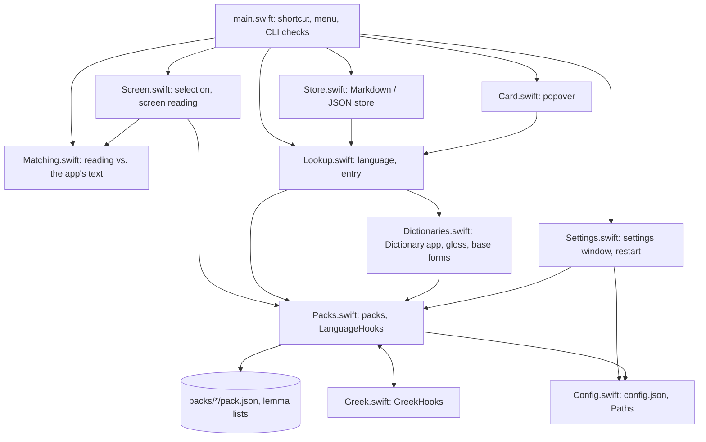
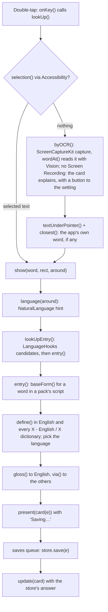
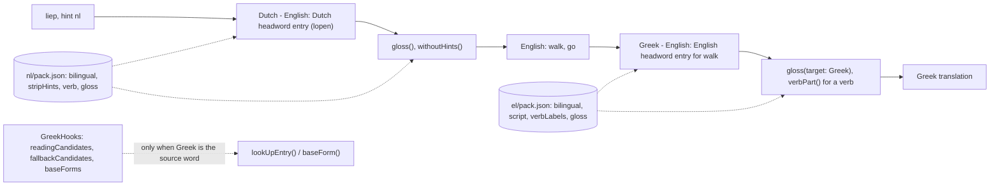
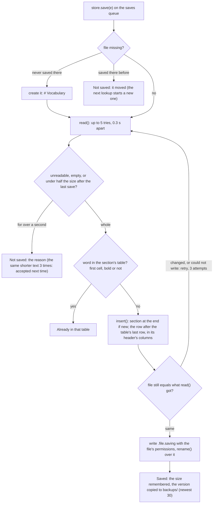
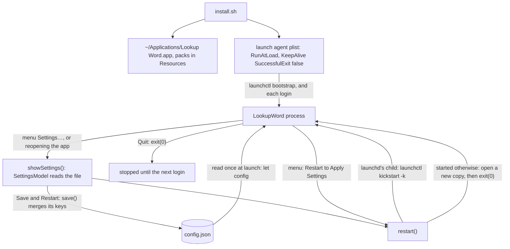

# Lookup Word design

Lookup Word is a macOS background app (no Dock icon) in one Swift executable. A double-tap of a modifier key picks a
word, looks it up offline in the dictionaries enabled in Dictionary.app, shows a card like Look Up's with the word in
every language in force, and saves it to a vocabulary file. This document shows how the parts fit. The
[README](../README.md) covers use and settings; [CONTRIBUTING](../CONTRIBUTING.md) covers language packs.

## 1. Components

- `main.swift` owns the flow: `onKey()` spots the double-tap, `lookUp()` picks the word, `show()` builds the entry,
  presents the card and hands the save to a serial `saves` queue.
- `Lookup.swift` builds an `Entry`; `Store.swift` and `Card.swift` only consume it. `Dictionaries.swift` holds the
  Dictionary.app calls (`define()`), the gloss extraction and the base-form search.
- `Packs.swift` loads `pack.json` per language and registers code hooks in `languageHooks`; `GreekHooks` is the only
  one, and it reads `packs` back. `Screen.swift` takes its Vision languages (`ocrLanguages`) from the packs.
- Not drawn, to keep it readable: almost every file reads `config`, `Paths` or `log()` from `Config.swift`, and the
  regex helpers `matches()`/`replacing()` and `fold()` from `Dictionaries.swift`.

## 2. A lookup, end to end

- `lookUp()` first checks the Accessibility permission. With a selection, `selection()` returns the selected text,
  its bounds and up to 1000 characters of the element's value as context.
- With nothing selected, `byOCR()` captures a 640×90 pt region around the pointer (excluding the app's own windows).
  `wordAt()` finds the line and word with `VNDetectTextRectanglesRequest`, reads the word's crop three ways and keeps the
  surest, and reads up to four neighbours a side. `closest(_:in:)` then picks the word of the element's real text that
  best fits the reading and its neighbours (look-alike letters folded by `shape()`). Without element text, the raw
  reading is used; with no reading at all, the card asks for Screen Recording or says no word was found.
- `show()` falls back to `corrected()` (spell-checker guesses in the hint language) when `lookUpEntry()` finds nothing.
  The card appears at once; the store's answer replaces "Saving…" only if no newer lookup started (`shown == mine`).

## 3. Translation through English

English is the pivot: each language needs only its X - English dictionary. A word of language X gets its English from
its own X - English entry, and every other language from the English side of that language's X - English dictionary.

- `entry()` tells the two sides of a bilingual dictionary apart with `englishSide()`: English headwords carry a
  pronunciation (`| rʌn |`), the other language's do not. `via()` accepts only an English-side entry whose headword
  starts with the English word.
- For an English word, `entry()` skips the first hop: each language's translation is the gloss of its X - English entry
  for that word (`verbPart()` when `isVerb()` says it is a verb).
- Data in `pack.json` covers most of a language: dictionary names, `script`, `recognizer`, `ocr`, `spellChecker`,
  verb rules, `stripHints`, `lemmas` and gloss labels. Code in `LanguageHooks` covers what data cannot: Greek maps
  Cyrillic/Latin look-alike readings back to Greek letters and lists the dictionary forms a regular ending points to,
  which `deeperBase()` tries after the lemma list.

## 4. The Markdown store's safe write

The vocabulary file may live in a notes vault that another app syncs or saves at the same moment. `MarkdownStore.save()`
works hard not to write over a file it hasn't read whole, or one that changed since it read it.

- The size after each save is kept in `sizes/` in the support folder, one small file per vocabulary file, so a read that
  comes back much shorter (half a file, while a sync client writes it) is skipped. The same short text for over a
  second means a file shortened on purpose: its size is remembered, and the next save accepts it.
- `insert()` keeps the file's line endings (LF or CRLF), finds the section by its heading (`## Dutch`, any case, or the
  code), and writes the row in the table's own header order ("Meaning", "Added", a language's name or code); a value the
  table has no column for is named in the status line. A symlinked note is written where it points.
- The first save also copies the file as it was (`…-before.md`), so the version before Lookup Word touched it is kept.
- The compare-and-swap is "re-read, compare, rename": a writer between the compare and the `rename()` can still lose,
  but no reader ever sees a half-written file, and the `saves` queue keeps the app's own saves in order (a `--save` from
  the command line runs in its own process and relies on the compare).
- `JSONStore` is simpler: decode the list, append, one atomic write; no backups or compare.

## 5. Settings and restart

- `config` is read once per process. Each key decodes on its own (`lenient()`): a bad value keeps its default and adds a
  warning to the card's status line; a file that is not JSON sets `configBroken`, and the store becomes `BrokenStore`,
  which saves nothing until it is fixed. A missing file is written out with the defaults.
- `SettingsModel.save()` and `setSetting()` rewrite only their own keys and keep every other key. A file that isn't
  JSON: `setSetting()` leaves it alone; `SettingsModel.save()` keeps a copy as `config.broken.json`, then writes.
- `restart()` asks launchd to restart the job (`launchctl kickstart -k`) when launchd started it (parent pid 1), falling
  back to a failure exit, which `KeepAlive` with `SuccessfulExit` false also restarts; launchd waits until a job has run
  10 seconds. Started any other way, it opens a new copy of itself before quitting. Quit exits 0, so launchd leaves it
  stopped.
- `install.sh` builds a release binary, assembles and signs the app (its own certificate if there is one, else ad hoc,
  which resets the permissions), writes `~/Library/LaunchAgents/io.github.gregth.lookup-word.plist` with stderr to
  `~/Library/Logs/Lookup Word/lookup.log`, then `bootout` and `bootstrap` reload it.
